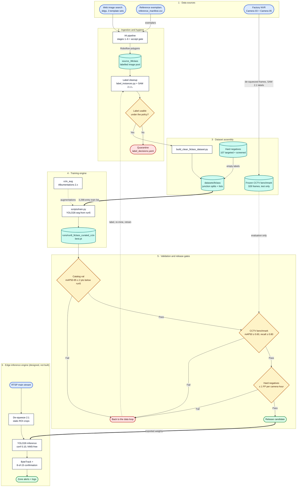
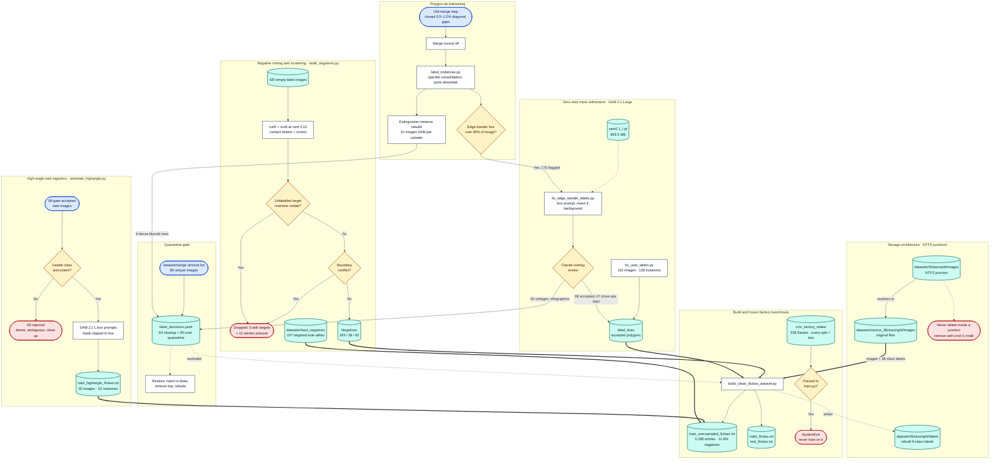
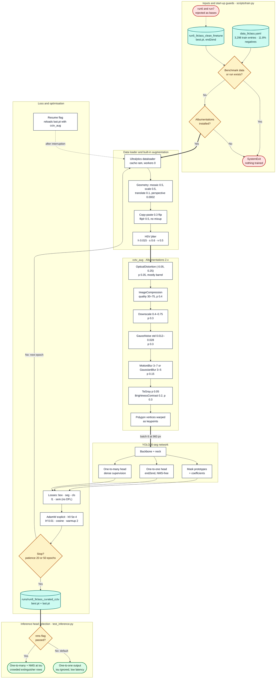
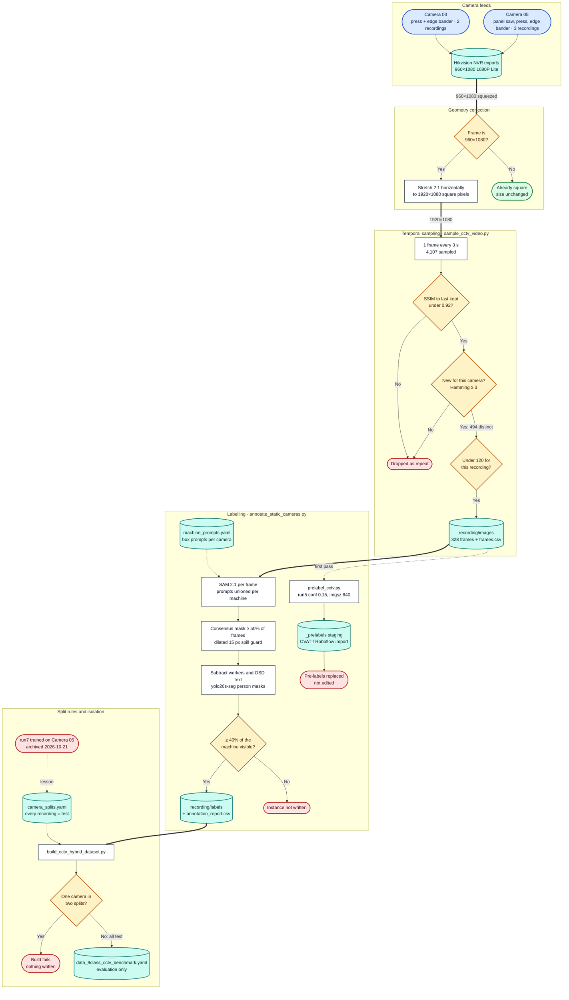
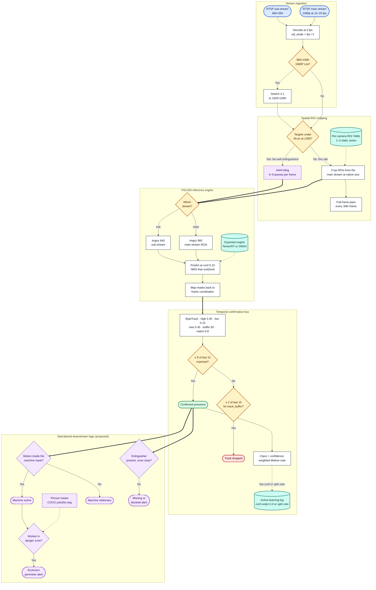

# Krish system architecture

9-class industrial woodworking machinery instance segmentation, with CCTV domain adaptation. Written 2026-10-23, while run8 is still training.

This document describes six subsystems. Each has:
- an overview: purpose, inputs, outputs and acceptance targets;
- a Mermaid flowchart;
- a component dictionary: what each block does, where it lives, and its edge cases;
- failure modes and mitigations.

**Diagram images:**
- **Location:** PNG (220 dpi) and SVG copies of every flowchart are in `docs\diagrams\`, ready to insert into Word or Google Docs.
- **Source:** the images are drawn straight from the Mermaid blocks in this file, so this file is the single source.
- **Regenerate:**

```powershell
env\yolo-env\Scripts\python.exe scripts\tools\generate_architecture_diagrams.py
```

| Shape | Meaning |
|---|---|
| Rectangle | Processing step |
| Capsule | Input, stream or outcome |
| Diamond | Decision, filter or threshold |
| Cylinder | Folder, list, database or checkpoint |
| Dashed purple border | Proposed: not in the codebase yet |

**Colours:**
- blue: source;
- white: process;
- amber: gate;
- teal: storage;
- red: rejected or dropped;
- green: accepted output.

**Paths:**
- The I4I scraper is its own git repository at `pipeline\`. Its stage scripts are in `pipeline\pipeline\`.
- Everything else is relative to the project root.

## Corrections to the original brief

The brief for this document had some details that don't match the code. The diagrams follow the code.

| Brief said | Code / records say | Source |
|---|---|---|
| 10 query templates per class | Three sets: 15 default, 10 `cctv`, 8 `highangle`. The per-class cap (400) is split evenly across the active set. | `pipeline\pipeline\config.py` |
| `<class>_<md5>.jpg` from the image | The MD5 is of the **URL** (first 10 hex characters). It de-duplicates repeat URLs, not repeat pixels. pHash in stage 3 catches pixel duplicates. | `stage2_scrape.py` |
| Fine CLIP filter uses reference centroids | It uses the **mean similarity** to the class's reference images (≥ 0.30), plus rival-class checks for confusable pairs. | `stage4_clip_filter.py` |
| Quarantine file `quarantined_diagrams_54.json` | No such file exists. Quarantines are keys in `datasets\9class\label_fixes\label_decisions.yaml`: 64 from label cleanup (60 edge-bander and 4 extinguisher images), plus 80 from the user's `datasetchange` list. | `docs\label_policy.md` |
| Run 8 data has 11.6% hard negatives | 11.6% was the list after the high-angle images were added. After the user curation, the list has 3,298 entries and 11.8% negatives. | `docs\label_policy.md`, `docs\dataset_layout_9class.md` |
| Loss outputs include DFL | YOLO26 has no DFL. run5 and run8 log `box`, `seg`, `cls`, `l1` and `sem` losses. | `runs\run8_9class_curated_cctv\results.csv` |
| CCTV benchmark pre-labelled with run5 | run5 pre-labels were made, then **replaced**. The 328 benchmark labels come from SAM 2.1 box prompts with consensus clipping and worker subtraction. | `docs\factory_footage_analysis.md` §4.5 |
| Camera 03 = woodworking/press; Camera 05 = edge bander/panel saw | Camera 03 shows the press and edge bander. Camera 05 shows the panel saw, press and edge bander. | `docs\cctv_benchmark.md` |
| Edge pipeline, machine state, extinguisher and worker zones | The edge pipeline is a design (plan §4, todo §7) and is not built. Machine-state, extinguisher-zone and worker-zone logic are proposals and appear in neither the code nor the plan. | `docs\cctv_domain_adaptation_plan.md` |

---

## 1. Macro end-to-end architecture

**Purpose:** show the whole lifecycle, from web images and factory cameras to a released checkpoint and edge alerts.

| | |
|---|---|
| **Inputs** | Web image search, the reference exemplars, and the factory NVR (Camera 03, Camera 05). |
| **Outputs** | A checkpoint that passes the release gates, and per-camera confirmed detections and alerts. |
| **Acceptance targets** (plan §5.3) | All four gates must pass:<br>1. CCTV mask mAP50 ≥ 0.60 and recall ≥ 0.80 per class.<br>2. ≤ 1 false positive per camera-hour after temporal confirmation.<br>3. Catalog-val mask mAP50-95 within 2 points of run5.<br>4. Beats run5 on re-recorded trial clips. |
| **Status** | Stages 1–5 are built. run8 is training. Stage 6 is designed but not built. |

<!-- diagram: 01_macro_architecture | Macro end-to-end architecture -->


### Component dictionary

| Block | What it does | Implemented in | Edge cases |
|---|---|---|---|
| Web image search | Image search over query templates per class | `pipeline\pipeline\stage2_scrape.py` (`ddgs`) | Rate limits. The `ddgs` backend is Bing, not Google. |
| Reference exemplars | Hand-picked images that anchor the CLIP fine filter | `reference_manifest.csv`, `reference_images\` | Fewer than 3 references for a confusable class weakens the fine filter. |
| Factory NVR | Two fixed Hikvision cameras | `datasets\cctv_factory_intake\` | Video is 960×1080 "1080P Lite" and has to be de-squeezed. |
| I4I pipeline | Scrape → clean → CLIP gate → diversity → auto-annotate (subsystem 2) | `pipeline\pipeline\` | Only one mask is uploaded per image. |
| Label cleanup | De-balloons polygons, re-segments with SAM 2.1 L, screens negatives (subsystem 3) | `scripts\tools\` | Label review was done by Claude, not by a human annotator. |
| Quarantine | Removes unusable images from every list without deleting files | `label_decisions.yaml` | An image comes back only after someone re-draws it by hand. |
| Dataset build | Writes 9-class labels and train/val/test lists | `scripts\tools\build_clean_9class_dataset.py` | `images` folders are NTFS junctions. Never delete inside them. |
| Frozen benchmark | Held-out factory frames | `docs\cctv_benchmark.md` | Any frame from Camera 03 or 05 in training counts as leakage. |
| Training | Fine-tunes run5 with `cctv_aug` (subsystem 4) | `scripts\train.py` | Refuses to start without Albumentations, or with benchmark data. |
| Release gates | Four gates, all of which must pass | plan §5.3 | Classes with fewer than 50 test instances are reported but not gated. |
| Edge engine | Stream → ROI → inference → tracking → alerts (subsystem 6) | Not built | Choose the inference size per stream. |

### Failure modes

| Failure | Mitigation in place |
|---|---|
| Training on the target cameras (run7 memorised Camera 05) | Every benchmark recording is `test`. `train.py` refuses benchmark YAMLs. The run7 lists are archived. |
| Augmentations silently skipped | `train.py` exits if Albumentations is missing. Only 2.x argument names are used. |
| Catalog regression ("forgetting") | Gate 1 compares against run5 re-evaluated on the cleaned val. |
| Single-frame flicker at the edge | Low-confidence ByteTrack association plus an 8-of-15 confirmation window. |

---

## 2. I4I automated data harvesting and scraping pipeline

**Purpose:** turn an empty manifest into verified, auto-annotated training images for each class.

| | |
|---|---|
| **Inputs** | `reference_manifest.csv`, `reference_images\<class>\`, and the class list in `config.py` (38 classes in the pipeline; 9 target classes). |
| **Outputs** | Polygon annotations in the Roboflow project `full_try`. These were exported into `datasets\source_38class\`. |
| **Acceptance targets** | Per class after stage 5:<br>- K ≥ 80 images for standard classes;<br>- K ≥ 150 for confusable classes.<br>Classes below the floor are flagged. |
| **Hard limit** | Stage 6 uploads only `preds[0]`: **one mask per image**, even when an image shows several machines. |

```mermaid
flowchart TD
    classDef src fill:#DBEAFE,stroke:#1D4ED8,color:#0B1F4D,stroke-width:2px
    classDef proc fill:#FFFFFF,stroke:#334155,color:#0F172A,stroke-width:1.5px
    classDef gate fill:#FEF3C7,stroke:#B45309,color:#451A03,stroke-width:2px
    classDef store fill:#CCFBF1,stroke:#0F766E,color:#042F2E,stroke-width:2px
    classDef reject fill:#FEE2E2,stroke:#B91C1C,color:#450A0A,stroke-width:2px
    classDef out fill:#DCFCE7,stroke:#15803D,color:#052E16,stroke-width:2px
    classDef planned fill:#F3E8FF,stroke:#7E22CE,color:#3B0764,stroke-width:2px,stroke-dasharray:5 4

    subgraph P1["Stage 1 · Exemplar ingestion · stage1_ingest_refs.py"]
        MAN(["reference_manifest.csv"])
        ING["Validate and copy<br/>exemplar images"]
        REFQ{"Confusable class<br/>with ≥ 3 refs?"}
        REFS[("reference_images/class<br/>positive exemplars")]
        WEAK(["Flagged in report<br/>fine filter weak"])
    end
    subgraph P2["Stage 2 · Scraper engine · stage2_scrape.py"]
        TPL["Query expansion<br/>15 default · 10 cctv · 8 highangle"]
        DDG(["DuckDuckGo via ddgs<br/>1.5 s sleep, 5 retries"])
        SEEN{"URL already<br/>seen this run?"}
        DL["Download<br/>10 s timeout"]
        R200{"Both sides<br/>≥ 200 px?"}
        RAW[("dataset/train/class<br/>class_urlmd5.jpg")]
        SKIP2(["Skipped"])
    end
    subgraph P3["Stage 3 · Integrity hygiene · stage3_clean.py"]
        OPEN{"Opens and<br/>decodes?"}
        R150{"Both sides<br/>≥ 150 px?"}
        PHASH["Perceptual hash<br/>per image"]
        DUP{"Hamming ≤ 8 to<br/>a kept image?"}
        CLEAN[("Clean pool")]
        PURGE(["Removed"])
    end
    subgraph P4["Stage 4 and 4b · Hybrid OpenCLIP gate · stage4_clip_filter.py"]
        EMB["OpenCLIP ViT-B-32<br/>laion2b embeddings"]
        CAL["stage4b_calibrate.py<br/>recall-first threshold sweep"]
        COARSE{"Text gate<br/>sim ≥ 0.18, margin 0.05"}
        CONFQ{"Confusable<br/>class?"}
        FINE{"Image gate<br/>ref sim ≥ 0.30, no rival"}
        PASS4[("CLIP-passed pool")]
        REJ4(["Moved to rejected"])
    end
    subgraph P5["Stage 5 · Embedding diversity · stage5_diversity_kselect.py"]
        GREEDY["Greedy walk over<br/>CLIP embeddings"]
        SIM95{"Cosine to selected<br/>set ≤ 0.95?"}
        REDUND(["Dropped as<br/>redundant stock photo"])
        KFLOOR{"K ≥ 80 standard,<br/>≥ 150 confusable?"}
        KFLAG(["Class FLAGGED<br/>scrape more"])
        DIVERSE[("Diverse selection")]
    end
    subgraph P6["Stage 6 · Auto-annotation · upload_polygon_annotations.py"]
        SPLIT["70 / 15 / 15 split<br/>per class, seed 42"]
        WF["Roboflow workflow<br/>gemini-machine-instance-auto-label-2"]
        GEM{"Gemini: class matches<br/>the expected class?"}
        SAMT["SAM traces<br/>object contours"]
        P0{"Upload preds[0] only<br/>single mask per image"}
        RF[("Roboflow project full_try<br/>COCO polygons")]
        CONFLICT(["Class conflict<br/>not uploaded"])
        LOST(["Other instances<br/>never labelled"])
    end
    subgraph P7["Post-mortem reality gate · cctv_scrape_postmortem.md + stage2c_accept_gate.py"]
        CCTVS(["cctv template scrape<br/>2,677 images"])
        AUDIT["analyze_cctv.py audit"]
        FOUND(["723 byte copies · ~279 camera hardware<br/>about 5 real CCTV frames"])
        HAQ["highangle templates<br/>places, not cameras"]
        ACCEPT{"stage2c gate<br/>5 checks"}
        REVIEW{"Image review<br/>of 99 accepted"}
        HAOUT[("datasets/highangle<br/>30 images · 52 instances")]
    end

    MAN --> ING
    ING --> REFQ
    REFQ -->|"Yes"| REFS
    REFQ -->|"No"| WEAK
    TPL --> DDG
    DDG --> SEEN
    SEEN -->|"New"| DL
    SEEN -->|"Seen"| SKIP2
    DL --> R200
    R200 -->|"Yes"| RAW
    R200 -->|"No"| SKIP2
    RAW ==> OPEN
    OPEN -->|"Yes"| R150
    OPEN -->|"No: corrupt"| PURGE
    R150 -->|"Yes"| PHASH
    R150 -->|"No"| PURGE
    PHASH --> DUP
    DUP -->|"No"| CLEAN
    DUP -->|"Yes: duplicate"| PURGE
    CLEAN ==> EMB
    EMB --> COARSE
    CAL -.->|"sets thresholds"| COARSE
    COARSE -->|"Pass"| CONFQ
    COARSE -->|"Fail"| REJ4
    CONFQ -->|"No"| PASS4
    CONFQ -->|"Yes"| FINE
    FINE -->|"Pass"| PASS4
    FINE -->|"Fail"| REJ4
    REFS -.->|"reference embeddings"| FINE
    PASS4 ==> GREEDY
    GREEDY --> SIM95
    SIM95 -->|"No"| REDUND
    SIM95 -->|"Yes"| KFLOOR
    KFLOOR -->|"No"| KFLAG
    KFLOOR -->|"Yes"| DIVERSE
    DIVERSE ==> SPLIT
    SPLIT --> WF
    WF --> GEM
    GEM -->|"No"| CONFLICT
    GEM -->|"Yes"| SAMT
    SAMT --> P0
    P0 -->|"first mask"| RF
    P0 -.->|"rest dropped"| LOST
    TPL -.->|"cctv template set"| CCTVS
    CCTVS --> AUDIT
    AUDIT --> FOUND
    FOUND -->|"lesson: queries named cameras"| HAQ
    HAQ --> ACCEPT
    ACCEPT -->|"99 accepted"| REVIEW
    REVIEW -->|"30 kept, 69 rejected"| HAOUT

    class MAN,DDG,CCTVS src
    class ING,TPL,DL,PHASH,EMB,CAL,GREEDY,SPLIT,WF,SAMT,AUDIT,HAQ proc
    class REFQ,SEEN,R200,OPEN,R150,DUP,COARSE,CONFQ,FINE,SIM95,KFLOOR,GEM,P0,ACCEPT,REVIEW gate
    class REFS,RAW,CLEAN,PASS4,DIVERSE,RF,HAOUT store
    class WEAK,SKIP2,PURGE,REJ4,REDUND,KFLAG,CONFLICT,LOST,FOUND reject
```

<!-- diagram: 02_i4i_scraping_pipeline | I4I data harvesting and scraping pipeline -->


### Component dictionary

| Block | What it does | Implemented in | Edge cases |
|---|---|---|---|
| Exemplar ingestion | Validates the manifest rows and copies exemplars into `reference_images\<class>\` | `stage1_ingest_refs.py` | A confusable class with fewer than 3 references is flagged, not failed (`MIN_REFS_PER_CONFUSABLE_CLASS`). |
| Query expansion | Fills `{machine}` into each template. The class cap (400) is split evenly, with the remainder going to the first template. | `config.py` → `QUERY_TEMPLATES`, `CCTV_…`, `HIGHANGLE_…` | Before the 2026-10-21 fix, the first query could fill the whole cap. |
| DuckDuckGo search | Runs `DDGS().images()` and fetches up to 3× the template quota (60–100) | `stage2_scrape.py` `_search_with_retry` | Rate limits trigger exponential backoff from a 10 s base, up to 5 attempts, then move to the next query. |
| URL de-dup | Skips a URL already seen in this run, across templates and classes | `_SEEN_URLS`, MD5 of the URL | Different URLs with identical bytes get through. 27% of the CCTV scrape was byte copies. |
| Download + size check | 10 s timeout. Rejects images under 200 px on either side. | `stage2_scrape.py` | The download floor is `max(MIN_RESOLUTION, 200)`, stricter than stage 3. |
| Integrity hygiene | Removes corrupt files, images under 150 px, and pHash near-duplicates (Hamming ≤ 8) | `stage3_clean.py` | pHash misses crops and mirror images of the same photo. |
| Coarse text gate | Image–text similarity ≥ 0.18, and it must beat 20 negative prompts (drawings, ads, parts) by 0.05 | `stage4_clip_filter.py` | CLIP rewards product shots, so the gate keeps catalog style. |
| Fine image gate | Confusable classes only: mean similarity to the class's references ≥ 0.30, and no rival class's references closer | `stage4_clip_filter.py` | Planer references self-match as low as 0.17, which is why the threshold dropped from 0.55. |
| Calibration | Sweeps thresholds on good and bad samples and favours recall | `stage4b_calibrate.py` | Tuning for recall lets some off-class images through to stage 6. |
| Diversity selection | Greedy: an image is skipped if its cosine similarity to anything already selected is over 0.95 | `stage5_diversity_kselect.py` | Floors are flagged, not enforced. |
| Auto-annotation | Gemini checks the class, SAM traces the contour, and the polygon is uploaded to Roboflow | `upload_polygon_annotations.py`, `roboflow_workflow.py` | Only `preds[0]` is uploaded. In multi-machine images and extinguisher rows, the other objects stay unlabelled, which later surfaced as false negatives. |
| Post-mortem gate | Audited the CCTV scrape, then replaced it with place-based queries and a 5-check accept gate | `logs\cctv_scrape_analysis\`, `stage2c_accept_gate.py` | Rejected images are moved to `_gate_rejected\<reason>\`, never deleted. |

### Failure modes

| Failure | What happened | Mitigation |
|---|---|---|
| "CCTV" queries returned camera hardware | About 279 security-camera product photos and about 5 real CCTV frames | Use `highangle` templates and the stage 2c `clip_scene` gate's "security-camera hardware" negative prompt. |
| Byte-identical re-downloads | 723 of 2,677 (27%) | URL de-dup, plus stage 2c `in_batch_dup` / `catalog_dup` (dHash). |
| One mask per image | Missed instances in extinguisher rows and multi-machine shots | The 2026-10-21 label rebuild and `fix_user_labels.py` added the missing instances (subsystem 3). |
| Catalog bias | Product shots on white backgrounds dominate | Hard negatives, high-angle images and `cctv_aug`. The real fix is CCTV frames. |

---

## 3. Dataset sanitisation, label policy and benchmark isolation

**Purpose:** turn noisy auto-labels into the run8 training set, and keep the factory benchmark completely isolated.

| | |
|---|---|
| **Inputs** | `datasets\source_38class\` (images and 38-class labels), the review decisions, SAM 2.1 Large, the negative pools and the high-angle intake. |
| **Outputs** | `datasets\9class\` labels and lists.<br>- **Train:** `train_oversampled_9class.txt`, 3,298 entries, 11.8% negatives.<br>- **Val and test:** `valid_9class.txt` and `test_9class.txt`.<br>- **Benchmark:** a separate eval YAML. |
| **Acceptance targets** | No image from Camera 03 or 05 in any train or val list. Edge-bander boxes over 80% of the image fell from 48% to 20% in train and from 59% to 18% in val. |
| **Safety rule** | `images` folders are junctions into `source_38class`. Deleting inside them deletes the originals. Remove a junction with `cmd /c rmdir` only. |

<!-- diagram: 03_dataset_sanitization | Dataset sanitisation, label policy and benchmark isolation -->


### Component dictionary

| Block | What it does | Implemented in | Edge cases |
|---|---|---|---|
| Junction splits | `datasets\9class\{train,valid,test}_9class\images` point at `source_38class` | NTFS junctions with absolute targets | Recreate them if the project moves. `Remove-Item -Recurse` on a junction deletes the originals. |
| Merge step (off) | The old build closed gaps of 0.5–1.2% of the diagonal | `build_clean_9class_dataset.py` | It fused 3 extinguishers into 1 blob and ballooned edge banders into slabs. |
| Instance rebuild | Consolidates speckle, absorbs touching hoses and handles, keeps similar-sized neighbours apart | `scripts\tools\label_instances.py` | A dense, blurred row of cylinders can't be split. Those 4 images are quarantined. |
| Edge-bander refinement | SAM 2.1 proposes a tighter mask for each of 175 frame-filling boxes, inverting it if SAM picks the background | `fix_edge_bander_labels.py` | The review was by Claude, not a human annotator. |
| SAM 2.1 Large | Default segmenter for all annotation scripts | `models\pretrained\sam2.1_l.pt` | Mean IoU 0.886 against 0.880 for Base. Worse on mitre saws (0.877 vs 0.914). 271 ms per prompt. |
| User fixes | Reviewed boxes become SAM 2.1 L prompts, clipped to the box. Modifiers: `rect`, `fg`, `+class`. | `fix_user_labels.py`, `user_fix_polygons.json` | 28 proposals were corrected in a second pass, and 3 images were excluded. |
| Quarantine | Removes images from every list. Files stay in `source_38class`. | `label_decisions.yaml` keys | Restore only by hand re-drawing, then rebuild. |
| Negative screening | Runs run5 and run6 over all 420 empty-label images at conf 0.10, then reviews the contact sheets | `audit_negatives.py` | Drops are applied after sampling, so the other negatives stay fixed. |
| Veneer-press removal | The Camera 03 press is a woodworking press, so veneer-press negatives would teach it as background | `label_decisions.yaml` → `negatives` | Open decision: relabel these 12 as `hydraulic_press`. |
| Targeted hard negatives | Look-alikes: gas cylinders, drums, moulders, CNC routers, racking | `collect_hard_negatives.py`, `datasets\hard_negatives\` | Every look-alike's class must be clear-cut, or it leaves the list. |
| High-angle ingestion | 99 images reviewed, 30 accepted, then masks from SAM 2.1 L | `annotate_highangle.py`, `datasets\highangle\decisions.yaml` | #5 and #94 need hand drawing (SAM failed). 11 images contain other classes. |
| Build | Writes 9-class labels and lists | `build_clean_9class_dataset.py` | Edge bander is the smallest class (22 val instances), so its AP is noisy. |
| Benchmark guard | `train.py` exits if the data YAML names the benchmark or `cctv_factory_intake` | `scripts\train.py` | It only checks the YAML path and text. A hand-made list could still leak. |

### Failure modes

| Failure | Mitigation |
|---|---|
| Fused instances and ballooned polygons | Merge off, `label_instances.py`, SAM refinement |
| Unlabelled targets in "negatives" | Model-assisted screening of every empty-label image |
| Look-alike negatives conflicting with a class | Remove anything whose class is debatable (veneer presses) |
| Benchmark leakage | All-`test` camera splits, the `train.py` guard, and the run7 lists archived |
| Accidental deletion through junctions | Never delete inside `*_9class\images`; use `cmd /c rmdir` for junctions |

---

## 4. Model training, dual-head architecture and CCTV augmentation

**Purpose:** fine-tune the generalist run5 checkpoint toward CCTV conditions without losing catalog accuracy.

| | |
|---|---|
| **Inputs** | `runs\run5_9class_clean_finetune\weights\best.pt` and `datasets\9class\data_9class.yaml`. |
| **Outputs** | `runs\run8_9class_curated_cctv\weights\best.pt` and `last.pt`, plus `results.csv`. |
| **Budget** | 50 epochs, patience 20, batch 6 at imgsz 960 on an 8 GB RTX 3070 Ti.<br>Epoch 1 took about 59 min, epoch 2 about 42 min. |
| **Acceptance** | Release gates 1–4 (subsystem 1). |

<!-- diagram: 04_training_engine | Training engine, dual head and CCTV augmentation -->


### Component dictionary

| Block | What it does | Implemented in | Edge cases |
|---|---|---|---|
| Base checkpoint | run5 is the generalist champion. run6 regressed on the workshop clip, and run7 memorised Camera 05. | `train.py --weights` default | run5 is end2end (`Segment26` head). |
| Start-up guards | Exits on benchmark data, on an existing run folder (runs are never overwritten), or when Albumentations is missing | `train.py` `main()`, `cctv_aug()` | `--resume` skips the folder check by design. |
| Built-in augmentation | Geometry is turned down from the defaults. Roll and keystone don't model CCTV pitch. | `model.train(...)` arguments | `close_mosaic=10`: the last 10 epochs train without mosaic. |
| OpticalDistortion | Simulates wide-angle lens curvature | `cctv_aug()` | In 2.x, a negative limit means pincushion and a positive limit means barrel (checked on a grid). |
| ImageCompression | Simulates H.264-like blocking | `cctv_aug()` | The 1.x `quality_lower/upper` names are ignored silently. Use `quality_range`. |
| Downscale | Simulates a low-resolution sensor or the sub-stream | `cctv_aug()` | Uses `scale_range`, not `scale_min/max`. |
| GaussNoise | Sensor noise | `cctv_aug()` | `std_range` is a fraction of 255. The old `var_limit=(10, 50)` maps to (0.012, 0.028). |
| Blur, ToGray, brightness | Motion and focus blur, rare greyscale, exposure | `cctv_aug()` | ToGray is kept rare so colour still separates red cylinders from drums. |
| Keypoint warping | Ultralytics 8.4 passes polygon vertices to Albumentations as keypoints, so masks follow distortion | Ultralytics `Albumentations` transform | Checked on train batches. |
| One-to-one head | One prediction per object, no NMS. Used by default at inference. | YOLO26 `Segment26` | `iou=` has no effect unless `end2end=False`. |
| One-to-many head | Several positives per object during training. Can be used with NMS at inference. | YOLO26 `Segment26` | Useful when touching extinguishers collapse into one prediction. |
| Losses | `box`, `seg`, `cls`, `l1` and `sem` (from `results.csv`) | Ultralytics YOLO26 loss | Loss weights are left at their defaults (plan §5.2). |
| Optimiser | AdamW set explicitly, because `optimizer=auto` silently replaces `lr0` | `train.py` | The epoch-1 learning rate is in warmup (≈ 2.5e-4). |
| Checkpoints | `best.pt` is chosen on catalog val, `last.pt` is kept for resume | `runs\run8_…\weights\` | best.pt reflects catalog val, not CCTV. Gate 2 checks CCTV separately. |

### Failure modes

| Failure | Mitigation |
|---|---|
| Augmentations silently not running (run6 era) | Hard exit without Albumentations; 2.x names only; check the training log's `albumentations:` line |
| Over-strong degradation (run7) | Milder ranges than run7, with distortion added |
| Overwriting a run | The run-folder check (`exist_ok=False`) |
| Training interrupted | `--resume` from `last.pt` with the same `cctv_aug` |

---

## 5. Factory CCTV footage intake and pre-processing

**Purpose:** turn raw NVR recordings into standard, labelled evaluation frames.

| | |
|---|---|
| **Inputs** | Five recordings from Camera 03 (2) and Camera 05 (3), each 960×1080 "1080P Lite". |
| **Outputs** | 328 frames at 1920×1080 in `datasets\cctv_factory_intake\<recording>\images\`, with YOLO-seg labels in `…\labels\`.<br>Instances: `panel_saw` 257, `hydraulic_press` 328, `edge_banding_machine` 328. |
| **Funnel** | 4,107 sampled, then 494 distinct, then 328 kept (cap 120 per recording). |
| **Status** | Frozen on 2026-10-21 as a test-only benchmark. |

<!-- diagram: 05_cctv_intake | Factory CCTV footage intake and pre-processing -->


### Component dictionary

| Block | What it does | Implemented in | Edge cases |
|---|---|---|---|
| Camera feeds | Two fixed Hikvision cameras. Camera 03: 71 frames from 72 minutes. Camera 05: 257 frames. | `datasets\cctv_factory_intake\` | Camera 03 is nearly static, so few distinct frames. Each camera is effectively one viewpoint. |
| De-squeeze | Stretches 960×1080 "1080P Lite" back to 1920×1080 | `sample_cctv_video.py --resize 1920x1080` | De-squeezing didn't change run5 or run6 scores. It is kept for true geometry. YOLO coordinates are normalised, so labels survive either geometry. |
| Time stride | Decodes one frame every 3 s | `sample_cctv_video.py --stride` | — |
| SSIM de-dup | Keeps a frame if SSIM to the last kept frame is under 0.92 (160 px greyscale) | same | The plan's default dHash ≥ 7 kept only 73 frames, because workers barely move a whole-frame hash. |
| Repeat guard | dHash Hamming ≥ 3 against every kept frame of the same camera, across recordings | `--dedup-with` | Stops a scene that returns later from being kept twice. |
| Cap | At most 120 per recording, spread over the recording time | `--cap` | Two Camera 05 clips hit the cap. |
| SAM labelling | Box prompts → SAM 2.1 → consensus clip → workers and OSD text removed → visibility check → polygons | `annotate_static_cameras.py`, `machine_prompts.yaml` | Spot-checked on about 25 overlays, not hand-drawn. A carriage prompt bled onto the floor and was removed. |
| Pre-labels | Low-confidence run5 pass into a CVAT/Roboflow staging export | `prelabel_cctv.py` | Never written to `labels\`, so unreviewed labels can't reach training. 42 of the panel-saw pre-labels were mis-classed as `table_saw`. |
| Camera splits | Maps each recording to a camera and a split | `camera_splits.yaml` | All five recordings are `test`, frozen after run7. |
| Leak check | Fails the build if one camera appears in two splits | `build_cctv_hybrid_dataset.py` | Tested by moving `working_panel_saw` to train. |

### Failure modes

| Failure | Mitigation |
|---|---|
| Training on the evaluation cameras | All-`test` splits, the `train.py` guard, run7 archived |
| Too few distinct frames from a static camera | SSIM de-dup and a repeat guard instead of a fixed frame count |
| Labels covering workers or stock | Consensus clipping, worker subtraction, 40% visibility rule |
| Burned-in OSD text | Subtracted from masks; future recordings should be raw RTSP |

---

## 6. Edge deployment, multi-frame tracking and safety alerting

**Purpose:** run the released model on live cameras and turn per-frame detections into stable, actionable events.

| | |
|---|---|
| **Status** | **Designed, not built.** Stages 1–4 come from `docs\cctv_domain_adaptation_plan.md` §4 and todo §7. The operational logic in stage 5 is a proposal, shown with dashed borders. |
| **Inputs** | RTSP streams. Hikvision channel `101` is the main stream and `102` the sub-stream. |
| **Outputs** | Confirmed machine presence per camera and ROI, plus alerts and an active-learning log. |
| **Throughput target** | Decode at 5 fps. One RTX 3070 Ti serves about 8–10 cameras (17–22 ms per frame end-to-end, measured at imgsz 1280). |
| **Alert target** | Gate 2: ≤ 1 false positive per camera-hour after confirmation. |

<!-- diagram: 06_edge_deployment | Edge deployment, tracking and safety alerting -->


### Component dictionary

| Block | What it does | Source of the design | Edge cases |
|---|---|---|---|
| Main / sub-stream | Prefer the main stream. The 480×360 sub-stream loses the resolution the model needs. | plan §1, §4.1 | Upsampling the sub-stream hurts: run5 scored 0.56 at imgsz 960 but 0.27 at 1280. |
| 5 fps decode | All 9 classes are stationary, so 30 fps adds cost, not information | plan §4.2 | Set `vid_stride` from each camera's real fps. |
| De-squeeze | Same 2:1 stretch as the intake | subsystem 5 | Only for "1080P Lite" channels. |
| ROI crops | 1–3 static zones per camera, cropped from the main stream at native size, masks mapped back | plan §4.1 | A low-rate full-frame pass catches moved items such as extinguishers. |
| SAHI | Tiling, only for wide-angle main streams with targets under ~40 px | plan §4.1 | Not installed. 6–9 forward passes per 4K frame. |
| Engine | TensorRT or ONNX export of the released checkpoint | Proposed | Re-check NMS-free output after export, and keep the PyTorch fallback. |
| Inference size | 960 for main-stream ROIs (run8's training size), 640 for the sub-stream | todo §2, factory analysis §3 | The plan suggests sweeping {480, 640, 960} on CCTV-val. |
| ByteTrack | Its second matching stage extends tracks with low-confidence detections | plan §4.2 | Set `tracker="bytetrack.yaml"` explicitly; Ultralytics' default is different. |
| 8-of-15 window | Confirm at ≥ 8 matched frames out of 15 (3 s); drop at ≤ 2 of 15, held for `track_buffer` | plan §4.2 | Per-class thresholds come from CCTV PR curves, never from catalog val. |
| Class vote | Confidence-weighted vote over the track's lifetime | plan §4.2 | Stops table_saw/panel_saw flips. |
| Active-learning log | Saves frames with conf under 0.3 or a split class vote | plan §4.2, §5.4 step 8 | This becomes next month's labelling queue. |
| Person masks | The 9-class model has no person class. Reuse the COCO model already used for worker subtraction. | Proposed | Workers hide machines; occlusion must not drop a confirmed track. |
| Machine state | Frame difference or optical flow inside the confirmed machine mask | Proposed | Moving workers and stock create false motion. Subtract person masks first. |
| Extinguisher zone | Alert if a confirmed extinguisher drops out of its zone, or if a person or object covers the zone for N seconds | Proposed | The Camera 03 drum is a known false positive, so hold out per-camera thresholds. |
| Worker exclusion | Alert when a worker polygon enters an active machine's danger zone | Proposed | Needs danger zones drawn per camera and a hold time to avoid alert storms. |

### Failure modes

| Failure | Mitigation |
|---|---|
| Single-frame flicker | ByteTrack low-confidence association plus the 8-of-15 window |
| Class flips between look-alikes | Confidence-weighted lifetime vote |
| Overlay text in recordings | Record raw RTSP, not screen recordings |
| Model drift on new cameras | Active-learning log, a monthly fine-tune, and re-running the gates |

---

## Rendering and validation

- **Rendering:** `scripts\tools\generate_architecture_diagrams.py` reads every ```` ```mermaid ```` block that follows a `<!-- diagram: <file> | <title> -->` marker. It lays each one out as top-to-bottom bands, one per subgraph, and writes `docs\diagrams\<file>.png` and `.svg`.
- **Validation:** before drawing, the script checks every block against the Mermaid subset used here:
  - every statement must parse;
  - subgraph/end must balance;
  - ids must be unique and not reserved;
  - every edge end must be declared;
  - every class must be defined;
  - labels must avoid characters Mermaid treats specially (`"`, `;`, `#`, `&`, backticks, bare `<` or `>`).
- **Limits of that check:** Node.js and mermaid-cli aren't installed on this machine, so the blocks were not run through mermaid.js itself. The local layout also differs from mermaid.js's: same nodes and edges, different placement.
